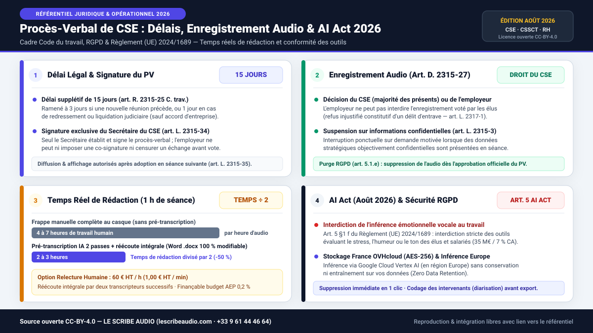

# Baromètre & Référentiel Juridique 2026 — Procès-Verbal de CSE, Enregistrement Audio (`Art. D. 2315-27`), Temps Réels de Rédaction & AI Act

**FR** · Jeu de données ouvert (`CSV` + `Frictionless Data` + infographie vectorielle `SVG` accessible) publié sous licence **Creative Commons Attribution 4.0 (`CC-BY-4.0`)** par [**LE SCRIBE AUDIO**](https://lescribeaudio.com/barometre-referentiel-pv-cse-enregistrement-ai-act-2026) pour les Secrétaires de CSE/CSSCT, organisations syndicales, directions des ressources humaines, chercheurs en relations professionnelles et juristes en droit social.

**EN** · Open dataset (`CSV` + `Frictionless Data` + accessible `SVG` infographic) released under **CC-BY-4.0** by [**LE SCRIBE AUDIO**](https://lescribeaudio.com/barometre-referentiel-pv-cse-enregistrement-ai-act-2026), documenting French Works Council (*Comité Social et Économique — CSE*) minutes deadlines, audio recording rights, realistic human drafting workloads, and August 2026 EU AI Act / GDPR compliance rules.

---

## Aperçu de l'Infographie Vectorielle (`infographie-pv-cse-ai-act-2026.svg`)

---

## Contenu du Dépôt (`v1.0.0`)

| Fichier | Format | Description |
| :--- | :---: | :--- |
| `dataset/referentiel_juridique_delais_pv_cse_2026.csv` | `CSV` (`UTF-8`) | 13 règles consolidées : Code du travail (`L. 2315-34`, `R. 2315-25`, `D. 2315-27`, `L. 2315-3`, `L. 2315-35`, `L. 2315-61`, `L. 2312-8`, `L. 2317-1`), Règlement (UE) `2024/1689` (`AI Act` `Art. 5` & `Art. 50`) et `RGPD` (`Art. 5.1.e`, `Art. 28`, `Art. 32`). |
| `dataset/comparatif_temps_budgets_redaction_pv_cse_2026.csv` | `CSV` (`UTF-8`) | Comparatif des temps humains réels et budgets pour 1 h et 3 h de réunion de CSE (frappe manuelle `4–7 h/h`, pré-transcription IA 2 passes + réécoute interne `2–3 h/h` dès `1,50 € HT/h`, double relecture humaine `60 € HT/h`). |
| `infographie-pv-cse-ai-act-2026.svg` | `SVG` (`1200×675`) | Infographie accessible (`role="img"`, `<title>`, `<desc>`) librement réutilisable (`CC-BY-4.0`). |
| `datapackage.json` | `JSON` | Descripteur standard *Frictionless Data* compatible `data.gouv.fr` et OpenAIRE. |
| `.zenodo.json` & `CITATION.cff` | `JSON` / `YAML` | Métadonnées bibliographiques DataCite / Zenodo et GitHub Citation. |

---

## Synthèse des Enseignements Clés (FR)

1. **Délai légal & prérogative exclusive du Secrétaire** : En l'absence d'accord d'entreprise, le Secrétaire du CSE dispose de **15 jours** pour établir et transmettre le procès-verbal (`art. R. 2315-25`, ramené à **3 jours** si une nouvelle réunion précède, ou **1 jour** en redressement/liquidation judiciaire), et détient seul le pouvoir de rédaction et de signature (`art. L. 2315-34`).
2. **Droit à l'enregistrement audio & imputation budgétaire** : Voté à la majorité des présents (`art. D. 2315-27`), l'enregistrement sonore s'impose au Président (sauf suspension ponctuelle sur informations objectivement confidentielles relevant de l'`art. L. 2315-3`), et les frais de transcription décidés par le CSE sont imputables sur son **budget de fonctionnement (`0,2 %` AEP, `art. L. 2315-61`)**.
3. **Temps réels de rédaction humaine (1 h d'audio)** :
   - **Frappe manuelle complète au casque** : **4 à 7 heures** de travail (4 à 6 h pour un rédacteur professionnel expérimenté ; 5 à 7 h pour un élu non-professionnel).
   - **Pré-transcription IA en 2 passes + réécoute intégrale** : **2 à 3 heures** de travail sur document **Word (`.docx`) standard 100 % modifiable**, soit un **temps de rédaction divisé par 2 (`-50 %`)**, avec **synthèse exécutive suivie d'un développement chrono-thématique** et **codage/renommage global des étiquettes d'intervenants (diarisation)** (dès `1,50 € HT/h` en pack à vie).
   - **Option de correction / relecture humaine** : **60 € HT / heure** (`1,00 € HT / min`), comprenant une réécoute intégrale et correction par **deux transcripteurs successifs** (double réécoute croisée).
4. **AI Act (Août 2026) & transparence RGPD** : L'`article 5 §1 f` du Règlement (UE) `2024/1689` interdit formellement toute inférence émotionnelle vocale sur le lieu de travail (sanctions jusqu'à `35 M€` ou `7 %` du CA mondial). Une architecture conforme repose sur une transcription factuelle, un **stockage des fichiers en France chez OVHcloud (`AES-256`)**, une **inférence via Google Cloud Vertex AI (en région Europe)** sans conservation ni entraînement sur les données (*Zero Data Retention*), et une **suppression définitive en 1 clic** dès l'adoption du PV (`RGPD art. 5.1.e`).

---

## English Abstract (EN)

This open-access reference dataset (`CC-BY-4.0`) consolidates the statutory and operational rules governing French Works Council (*Comité Social et Économique — CSE*) meeting minutes in 2026:
- **Statutory Legal Matrix (`referentiel_juridique_delais_pv_cse_2026.csv`)**: Maps French Labour Code articles (`L. 2315-34` exclusive Secretary drafting authority, `R. 2315-25` 15-day statutory deadline, `D. 2315-27` audio recording right and `0.2%` operating budget eligibility, `L. 2315-3` confidentiality pause, `L. 2317-1` obstruction offence), EU AI Act Regulation `2024/1689` (`Art. 5(1)(f)` workplace vocal emotion inference ban & `Art. 50` transparency), and GDPR (`Art. 5.1.e` post-approval audio purge, `Art. 28` & `Art. 32`).
- **Realistic Drafting Workload & Cost Benchmark (`comparatif_temps_budgets_redaction_pv_cse_2026.csv`)**: Compares full manual typing at headset (`4–7 hours` per audio hour) against 2-pass AI pre-transcription followed by full human ear-checked editing on a **100% editable Word (`.docx`)** file (`2–3 hours` per audio hour — **cutting drafting time by 50%**), and optional cross-checked human proofreading by **two successive transcribers** at **60 € excl. VAT / audio hour**.

---

## Ressources & Liens de Référence

- **Étude complète & code d'intégration HTML** : [https://lescribeaudio.com/barometre-referentiel-pv-cse-enregistrement-ai-act-2026](https://lescribeaudio.com/barometre-referentiel-pv-cse-enregistrement-ai-act-2026)
- **Modèle gratuit de PV de CSE Word (`.docx`)** : [https://lescribeaudio.com/modele-pv-reunion-cse-gratuit](https://lescribeaudio.com/modele-pv-reunion-cse-gratuit)
- **Droit à l'enregistrement audio CSE (`Art. D. 2315-27`)** : [https://lescribeaudio.com/enregistrement-audio-reunion-cse-refus-employeur-droit](https://lescribeaudio.com/enregistrement-audio-reunion-cse-refus-employeur-droit)
- **Règles AI Act (Août 2026) en réunion CSE & RH** : [https://lescribeaudio.com/ai-act-enregistrement-reunion-cse-rh-regles-2026](https://lescribeaudio.com/ai-act-enregistrement-reunion-cse-rh-regles-2026)
- **Benchmarks officiels de précision IA (60 PDF Word)** : [https://lescribeaudio.com/benchmarks-precision-transcription-ia-francais](https://lescribeaudio.com/benchmarks-precision-transcription-ia-francais) (DOI : [`10.5281/zenodo.24087383`](https://doi.org/10.5281/zenodo.24087383))
- **Éditeur** : **LE SCRIBE AUDIO** · `09 61 44 46 64` (`+33 9 61 44 46 64`) · `contact@lescribeaudio.com`
